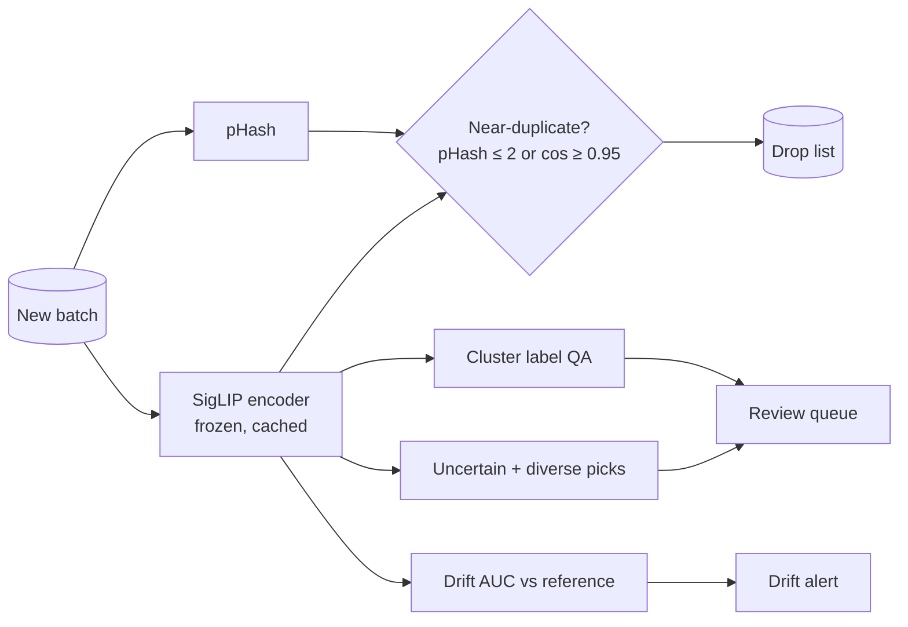

# data-flywheel

The quality loop for a product-image training set: catch near-duplicates, find wrong labels without ground truth, detect when a new batch looks different, and choose which images to label next. All four checks run on one set of SigLIP embeddings, and each is measured against problems planted on purpose, so its numbers can be trusted.

## Results

1,000 real catalog photos from a public fashion dataset, plus 500 near-duplicates made from them (six types, labelled). CPU only: embedding took 4.2 minutes (6 images/s), and pHash took 0.2 s.

### Near-duplicates: neither method works alone, and the first thresholds were wrong

Recall by duplicate type (first thresholds: pHash Hamming ≤ 8, cosine ≥ 0.92):

| Method | Recompress | Resize | Crop | Flip | Pad | Colour | Precision | Recall |
| --- | --- | --- | --- | --- | --- | --- | --- | --- |
| pHash | 100% | 100% | 4% | 0% | 10% | 98% | 16.4% | 52.0% |
| Embeddings | 6% | 26% | 89% | 98% | 93% | 89% | 55.0% | 66.6% |
| Either | 100% | 100% | 89% | 98% | 94% | 100% | 23.3% | 96.8% |

The two methods fail in opposite places. pHash catches re-encodes and resizes but misses every flip and nearly every crop. Embeddings are the reverse: they treat a heavily recompressed copy as a different image. Combined, they find 96.8% of duplicates, but precision is poor. Plain products on white backgrounds hash alike, so a Hamming distance of 8 matched 1,326 pairs of different products.

The [threshold sweep](evals/SWEEP.md) found a much better operating point:

| Rule | Precision | Recall | False pairs |
| --- | --- | --- | --- |
| pHash ≤ 8 or cosine ≥ 0.92 (first try) | 23.3% | 96.8% | 1,590 |
| **pHash ≤ 2 or cosine ≥ 0.95** | **90.3%** | **78.0%** | **42** |
| cosine ≥ 0.97 alone | 100.0% | 19.0% | 0 |

### Label errors, found without ground truth

5% of labels were flipped at random (34 of 692). The cluster check flags an image whose label disagrees with the majority label of its embedding cluster. It flagged 58 images and caught 71% of the flips (24), at 41% precision. A reviewer looking at 58 images instead of 692 finds most of the errors.

### Drift

| Batches compared | Classifier AUC (0.5 = indistinguishable) |
| --- | --- |
| Summer vs Winter products | **0.901** |
| Two random halves of the same data | 0.493 |

A classifier trained to tell two batches apart is a simple drift test. It clearly flags the seasonal shift and does not raise a false alarm on random halves.

### Active labeling: what to label next

Accuracy on held-out images after each round of 40 labels (article type):

| Labels | Random | Most uncertain | Uncertain + diverse |
| --- | --- | --- | --- |
| 40 | 24.8% | 24.8% | 24.8% |
| 80 | 44.8% | 39.1% | **55.2%** |
| 120 | 55.7% | 45.7% | **64.8%** |
| 160 | 61.3% | 58.7% | **77.0%** |
| 200 | 61.3% | 69.1% | **79.6%** |
| 240 | 67.8% | **80.9%** | 79.1% |

Picking the most uncertain images alone is worse than random for the first rounds. It keeps picking near-identical confusing images. Spreading the picks with k-means fixes this: 160 labels chosen that way beat 240 chosen at random.

### Index speed at scale (synthetic vectors)

An IVF index over 1,000,000 random 256-dimension vectors took 137 s to build and answered 3,342 queries/s. Recall@5 of planted near-duplicates was 65.2% at `nprobe=16`. Random vectors are the hardest case for IVF because they have no cluster structure. This measures index speed and should not be read as image-quality recall.

Full tables: [evals/RESULTS.md](evals/RESULTS.md) and [evals/SWEEP.md](evals/SWEEP.md).

## Architecture



Why one embedding backbone with a pHash prefilter: [ADR 1](docs/adr/0001-embedding-backbone-with-phash-prefilter.md), decided by a structured debate. Design, failure modes and scaling path: [docs/architecture.md](docs/architecture.md). Eraser sources: [docs/diagrams](docs/diagrams).

## Run it

```bash
pip install --extra-index-url https://download.pytorch.org/whl/cpu -e ".[dev]"
pytest -q
DF_BASE_IMAGES=1000 python evals/run_eval.py --write        # ~10 min on 2 CPU cores, including the 1M-vector index benchmark
DF_BASE_IMAGES=1000 python evals/threshold_sweep.py --write # reuses the embedding cache
```

## Code map

| Path | What it does |
| --- | --- |
| `src/flywheel/perturb.py` | Six labelled near-duplicate types |
| `src/flywheel/dedupe.py` | pHash, Hamming pairs, embedding pairs, IVF benchmark |
| `src/flywheel/quality.py` | Cluster label QA, drift AUC, active-learning selection |
| `src/flywheel/encoder.py` | SigLIP image embeddings |
| `evals/` | End-to-end measurement and threshold sweep |
