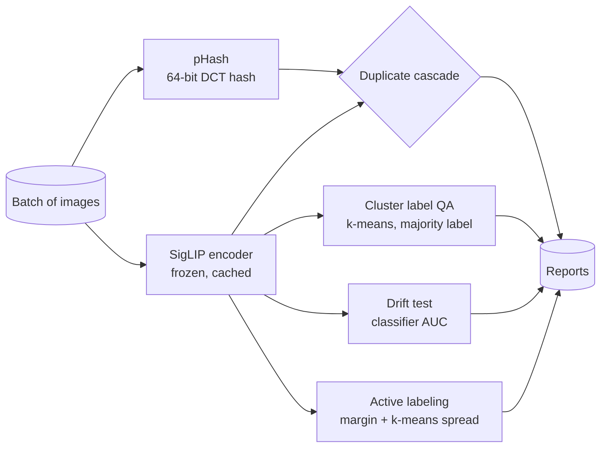
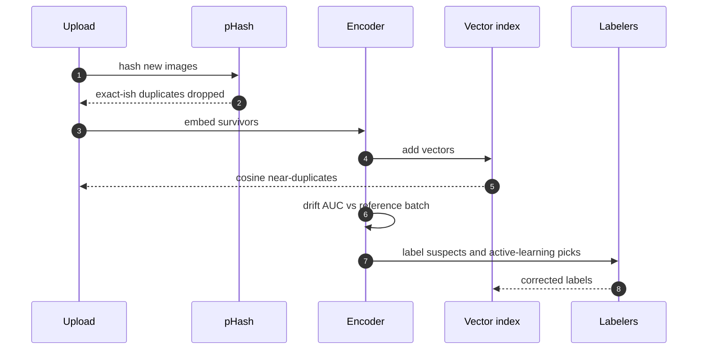

# Architecture

## Goals and non-goals

Goals:
- Keep a product-image training set clean as it grows: no near-duplicates, few wrong labels.
- Notice when a new batch looks different from what the model was trained on.
- Spend labelling effort on the images that improve the model most.
- Measure every check against planted ground truth, so its numbers can be trusted.

Non-goals:
- Training the downstream model; the flywheel feeds it.
- A labelling UI; the loop hands lists to whatever tool the team uses.

## Current architecture (v0.1)

## How each check works

| Check | Method | Planted ground truth in the eval |
| --- | --- | --- |
| Near-duplicates | pHash Hamming distance or cosine similarity over a Faiss index (union); thresholds chosen by sweep | One variant per original for half the images: six types (recompress, resize, crop, flip, pad, colour) |
| Label errors | Cluster embeddings; in clusters with a clear majority (70%+), flag images whose label disagrees | 5% of labels flipped at random |
| Drift | Train a classifier to tell two batches apart; cross-validated AUC near 0.5 means no drift | Summer vs Winter products (should drift); two random halves (should not) |
| Active labeling | Smallest top-2 margin; diversity variant clusters the 5n most uncertain and takes one per cluster | Accuracy on a held-out third after each round of 40 labels |

## Batch flow

## Code map

| Path | Responsibility |
| --- | --- |
| `src/flywheel/perturb.py` | The six near-duplicate types used to plant ground truth |
| `src/flywheel/dedupe.py` | pHash, Hamming pairs, embedding pairs, IVF benchmark |
| `src/flywheel/quality.py` | Cluster label QA, silhouette by label, drift AUC, active-learning selection |
| `src/flywheel/encoder.py` | SigLIP image embeddings |
| `evals/run_eval.py` | Runs all four checks and the index benchmark; writes `evals/RESULTS.md` |

## Failure modes

| Failure | Effect | Mitigation |
| --- | --- | --- |
| Look-alike products (plain items on white) | Counted as duplicates | False pairs reported separately; per-category cosine threshold |
| Label errors that form their own cluster | Cluster QA cannot see them | Pair with a confident-learning pass on a trained classifier |
| Small batches | Drift AUC noisy | Minimum batch size; compare against a fixed reference set |
| Encoder upgrade | Every threshold shifts | Re-run the full eval before switching |

## Scaling path

1. **v0.1 (now):** batch scripts, flat index for pairs, threshold sweep, IVF benchmark at 1M vectors.
2. **v0.2:** event-driven embedding workers, IVF-PQ index, nightly drift report.
3. **v0.3:** per-category thresholds, confident learning alongside cluster QA, labelling-tool integration.
